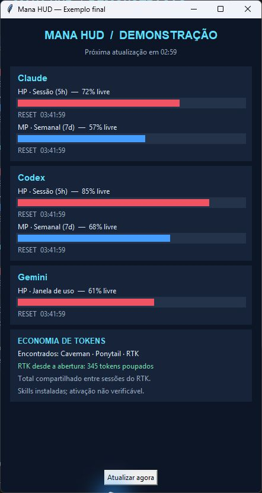
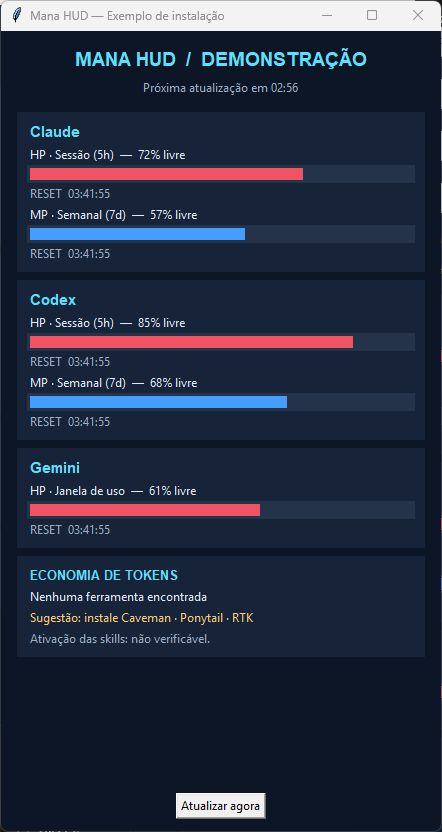
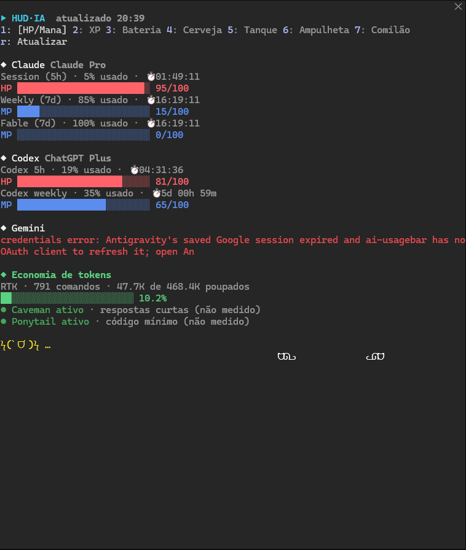

# Mana HUD 🎮

Uma barra de vida para suas sessões de IA. Acompanhe quotas e recargas de Claude, Codex e Gemini/Antigravity em uma janela para Windows e macOS. Interface pessoal de Thulio Buarque sobre o [ai-usagebar](https://github.com/akitaonrails/ai-usagebar), projeto independente de seus autores.

## Exemplos

As duas imagens a seguir mostram dados simulados, incluindo a economia de exemplo.





### Painel original no Claude



Esta captura do painel original contém dados reais de exemplo: planos, percentuais de uso, tempos de reset, estatísticas do RTK e uma mensagem de erro de autenticação do Gemini. Esses dados ficarão visíveis a todos se o repositório for público.

O painel original, incluído em `painel-claude.zip`, registra um callback `session.start` que tenta abri-lo quando uma sessão começa, desde que o plugin esteja instalado e o host ofereça a API de painel correspondente. Se o painel não puder ser posicionado, o código informa como abri-lo com `/hud-ia`. É um hook de início de sessão, não um `PreToolUse`; seu funcionamento depende do host e não foi verificado nesta revisão em uma nova sessão do Claude CLI. O painel da imagem é diferente da janela portátil Mana HUD.

## HP, MP e recarga

- **HP vermelho** prioriza a sessão; **MP azul** prioriza a janela semanal; SP é roxo. Quando esses rótulos não estão disponíveis, as métricas seguem a ordem informada pelo provedor. A porcentagem é a quota restante, não uma medida de tokens exatos.
- **Economia de tokens** mostra Caveman e Ponytail encontrados nas pastas de skills e RTK no PATH. Caso algum não seja encontrado, a HUD sugere instalá-lo e continua funcionando. A ativação das skills não é verificável pela HUD. Se o RTK estiver disponível, a HUD mostra o aumento de tokens poupados desde que abriu: o contador do RTK é compartilhado entre sessões e não isola uma conversa.
- **Reset** mostra o tempo até o horário informado pelo provedor. A quota efetiva depende da próxima resposta do serviço; o HUD não altera limites.
- **Refresh** consulta o ai-usagebar ao abrir e a cada 3 minutos. O relógio é redesenhado a cada segundo sem nova consulta. Use **Atualizar agora** para consultar imediatamente.

## Preparação

1. Instale e configure o [ai-usagebar](https://github.com/akitaonrails/ai-usagebar) e confira `ai-usagebar usage --json` no terminal. Configure as contas pelo próprio programa. A saída pode ser privada.
2. Instale Python 3 com Tkinter. No macOS, confirme `python3 -m tkinter`; no Windows, `python -m tkinter`. Se não abrir uma janela de teste, instale uma distribuição Python com Tk.
3. Clone ou baixe este projeto e execute dentro da pasta:

```sh
python3 mana_hud.py --window
```

No Windows, use `python mana_hud.py --window`. Feche a janela para encerrar. Sem `--window`, o comando inicia a HUD em segundo plano e termina imediatamente, para uso em hooks. Uma porta local evita janelas duplicadas.

## Abrir em novas sessões

Adicione um hook `SessionStart` às configurações do agente, **preservando os hooks existentes**. Use o caminho absoluto para o projeto e para o Python, se necessário. Exemplo de entrada macOS para incluir dentro de `hooks.SessionStart`:

```json
{
  "hooks": [{"type": "command", "command": "python3 /CAMINHO/para/mana-hud/mana_hud.py"}]
}
```

No Codex CLI, use `~/.codex/hooks.json` e aprove o hook em `/hooks` quando solicitado. No Claude Code, use `~/.claude/settings.json`. No Windows, adapte o comando ao shell do agente, por exemplo `python \"C:\\caminho\\mana-hud\\mana_hud.py\"` no JSON. Revise a configuração e reinicie a sessão. Ambiente gráfico e PATH podem diferir do terminal; use caminhos absolutos quando necessário. Os hooks podem exigir confiança ou aprovação no host. Referências: [Codex hooks](https://developers.openai.com/learn/codex/hooks) e [Claude Code hooks](https://code.claude.com/docs/en/hooks).

## Arquivos

- `mana_hud.py`: HUD portátil e inicializador de sessão.
- `SKILL.md`: instruções para o agente consultar e explicar o uso.
- `codex-hud.ps1` e `session-start.ps1`: versão Windows original, mantida como referência; requer ai-usagebar no caminho esperado pelo script.
- `painel-claude.zip`: painel lateral original experimental para um host Claude compatível, separado da janela portátil.

## Privacidade e limites

O Mana HUD executa o ai-usagebar localmente; autenticação e coleta pertencem à ferramenta e aos provedores. Não grave tokens nem publique a saída das consultas. A interface mostra mensagem genérica quando uma consulta falha. A HUD portátil não instala nem modifica hooks automaticamente. Windows foi testado neste ambiente; macOS e execução de hooks em uma sessão real ainda precisam de validação. A janela usa Tk e requer uma sessão gráfica.
